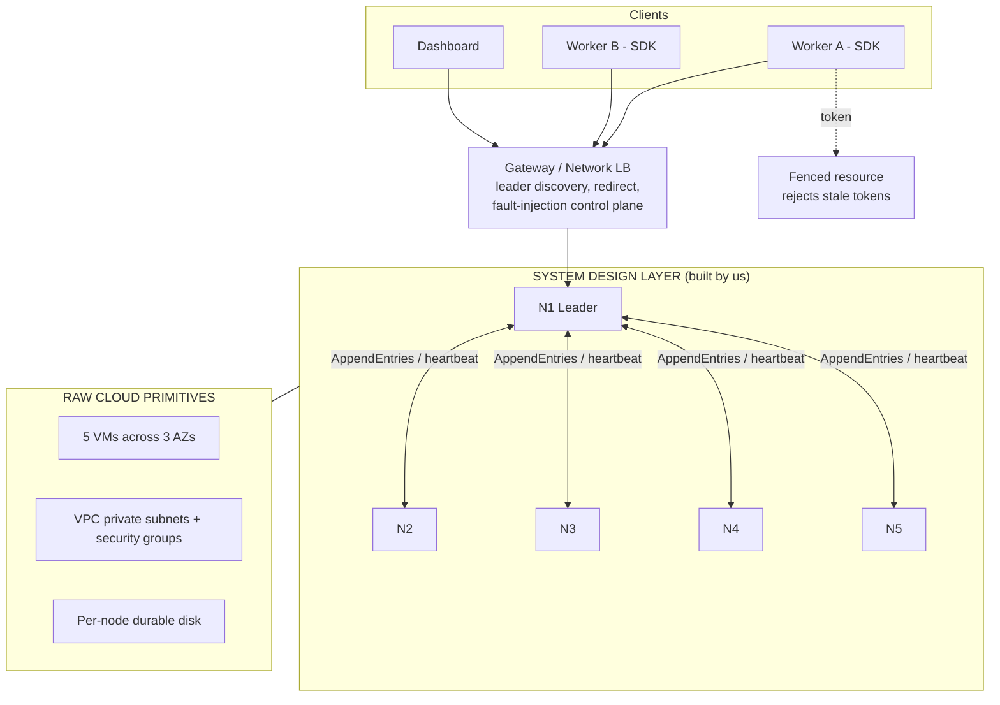
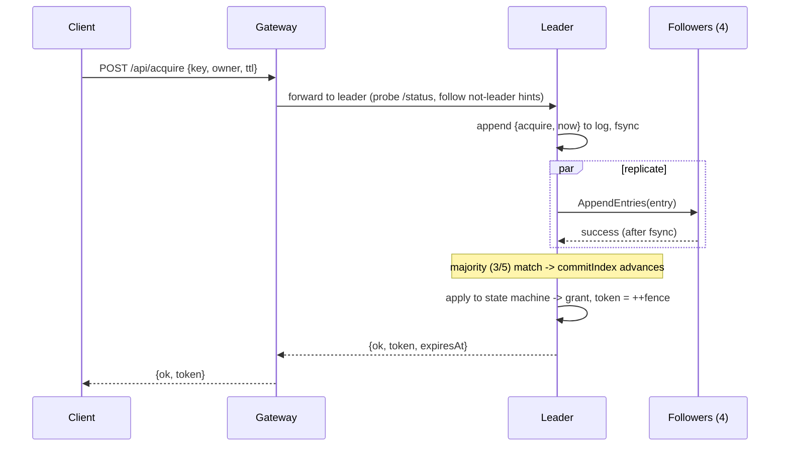
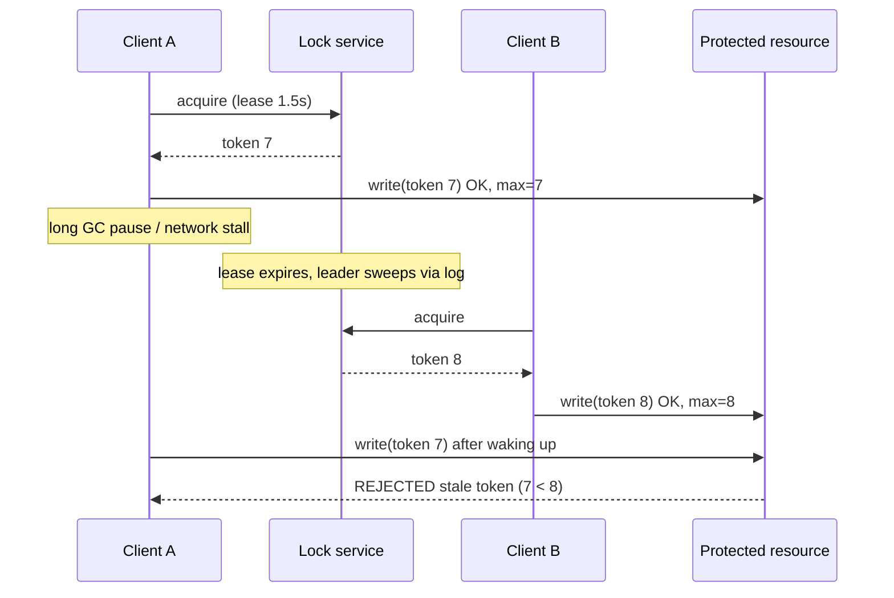

# Phase 1 - Architecture, Data Flow and Failure Strategy
**Topic 13: Fault-Tolerant Distributed Lock Service** (Chubby / etcd-style coordinator with fencing tokens)
Underlying primitives: Cloud VM cluster, Virtual Private Cloud (VPC).

## 1. Goal and guarantees

The cloud primitives (VMs, disks, a VPC) give us unreliable machines and an unreliable network. The abstraction layer we build on top provides:

| Guarantee | How |
|---|---|
| **Mutual exclusion** - at most one holder per key at any logical time | Every lock operation is a command in a Raft-replicated log; the state machine grants a lock only if no unexpired holder exists. |
| **Linearizable operations** | All reads and writes go through (or are lease-confirmed by) the single Raft leader. |
| **Fault tolerance** | 5 replicas, majority quorum (3). Survives any 2 crashes or a minority partition. |
| **Safety against stale holders (fencing)** | Each grant returns a strictly increasing 64-bit-style fencing token; downstream resources reject any token lower than the highest seen. |
| **Liveness of locks (no dead locks)** | Locks are leases with a TTL; a crashed client's lock expires and is swept by the leader through the log. |

## 2. System architecture diagram

See [architecture.svg](architecture.svg) (submit this image). Summary of the layers:

**Layer responsibilities**

| Layer | Component | Responsibility |
|---|---|---|
| Cloud primitive | VM cluster | Hosts one replica per VM, spread across availability zones so a zone loss costs at most 2 of 5 replicas. |
| Cloud primitive | VPC / security groups | Private subnets; only the gateway port is public, Raft ports are open only between replicas. |
| Cloud primitive | Block disk | Durable storage for term, vote and log. |
| Design layer | Raft module (`node.js`) | Leader election (with PreVote), log replication, commit rules, check-quorum, persistence. |
| Design layer | Lock state machine | `acquire / renew / release / sweep`, lease expiry, fencing counter. Deterministic: the timestamp is carried inside each command. |
| Design layer | Gateway (`server.js`) | Finds the leader, follows redirects, retries; hosts fault-injection and the demo fenced resource. |
| Design layer | Dashboard (`public/`) | Live view of roles, terms, logs, locks and events; fault-injection controls. |

## 3. Data and control pathways

### 3.1 Client write path (acquire / renew / release)

If the leader loses leadership before commit, the pending request is answered `leadership-lost` (outcome unknown to the client - the client re-reads or retries; acquire is idempotent for the same owner while the lease is live).

### 3.2 Client read path (lock table / status)

The leader answers only if it has received AppendEntries acknowledgements from a majority within the last 1.5 s (quorum lease). Otherwise it replies `not-leader` and the gateway re-discovers. This prevents a deposed leader in a minority partition from serving stale reads.

### 3.3 Fencing path

### 3.4 Background tasks (control plane)

| Task | Where | Period | Purpose |
|---|---|---|---|
| Heartbeat / replication | Leader | 120 ms | Replicate log, advance commit, refresh quorum lease. |
| Election timer | Follower / candidate | randomised 600-1100 ms | Detect leader failure; PreVote then RequestVote. |
| Check-quorum | Leader | 120 ms tick, 1.5 s limit | Leader steps down if it cannot reach a majority. |
| Lease sweeper | Leader | 300 ms | If any lock is past expiry, propose `sweep{now}` through the log so every replica deletes the same locks. |
| Persistence | Every node | on every term/vote/log change | Atomic write-then-rename of `term, votedFor, log`. |

### 3.5 Network boundaries

| Boundary | Traffic | Rule |
|---|---|---|
| Internet / client to Gateway | HTTP client API, dashboard | Only public entry point. |
| Gateway to replicas | Client commands, status, admin | VPC private subnet. |
| Replica to replica | Raft RPCs | Allowed only inside the replica security group. |
| Replica to disk | Local block device | Not network-reachable by other nodes. |

## 4. Failure and edge-case strategy

| # | Failure | Behaviour | Recovery / why it is safe |
|---|---|---|---|
| 1 | **Follower crash** | Leader keeps committing with the remaining majority. | On restart the node reloads term/vote/log from disk, receives missing entries via AppendEntries (backtracking `nextIndex` with a conflict hint), rebuilds the lock table by replay. |
| 2 | **Leader crash** | Writes stall until a follower's election timer fires (about 0.6-1.1 s). New leader appends a no-op in its term, which commits all earlier entries. | Granted locks survive because they were committed to a majority before the client was acked. Raft election restriction guarantees the new leader has every committed entry. |
| 3 | **Up to 2 of 5 nodes down** | Service stays available (quorum 3). | Restart nodes any time. |
| 4 | **3+ nodes down** | No quorum: writes time out, reads return `not-leader`. The service chooses **consistency over availability** (CP). | Restarting enough nodes restores a quorum and the state from disk. |
| 5 | **Network partition 2 vs 3** | Majority side elects/keeps a leader and serves. Minority-side leader detects loss of majority (check-quorum) and steps down; it cannot commit anything. | On heal, minority nodes see the higher term, truncate any uncommitted conflicting entries and catch up. No split brain: only one leader can hold a majority per term. |
| 6 | **Isolated leader** | Same as above: old leader's writes never commit (`timeout` / `leadership-lost`); a new leader is elected on the other side. | Old leader steps down on heal. |
| 7 | **Partitioned minority disrupting the cluster** | PreVote: an isolated node cannot raise the term because nobody grants its pre-vote, so rejoining does not force a needless election. | - |
| 8 | **Message loss / delay / duplication** | RPCs have 300 ms timeouts and are retried by heartbeat; AppendEntries is idempotent (log-matching check). | - |
| 9 | **Client crashes while holding lock** | Lock lives until TTL, then the leader's sweeper releases it through the log. | Bounded unavailability = TTL. |
| 10 | **Client pause beyond lease (zombie holder)** | Another client gets the lock. The zombie's later write carries an old token. | Resource rejects `token < max seen` (fencing); this is the guarantee mutual exclusion alone cannot give. |
| 11 | **Duplicate / retried client request** | `acquire` by the same owner while the lease is live returns the same token; `release/renew` require matching `owner + token`, so a stale client cannot release someone else's lock. | - |
| 12 | **Leader clock vs. replica clocks** | Expiry decisions use the leader's timestamp stored in the committed command, so all replicas apply identical results regardless of local clocks. After a leader change the new leader's clock is used for later commands (assumes loosely synchronised clocks, e.g. NTP/chrony in the VPC; TTLs of seconds make small skew harmless). | Documented assumption. |
| 13 | **Disk write interrupted during crash** | Persisted via temp file + atomic rename, so the file is either the old or new consistent version. | - |
| 14 | **Gateway failure** | Stateless apart from the demo resource; run several behind the load balancer. Clients can also contact any replica and follow the `leader` hint. | - |
| 15 | **Split vote** | Randomised election timeouts make repeated ties unlikely; a candidate that does not reach a majority retries. | - |

### Recovery steps summary

1. Process restarts, loads `term`, `votedFor`, `log` from disk (state machine is empty, `commitIndex = 0`).
2. Starts as follower; first valid AppendEntries from the leader supplies `leaderCommit`.
3. Log is reconciled (conflicting suffix truncated, missing entries appended).
4. Entries up to `commitIndex` are replayed into the lock table; node is now current.

## 5. Mapping to the implementation

| Design element | File |
|---|---|
| Raft + lock state machine | `node.js` |
| Gateway, leader routing, fault injection, fenced resource | `server.js` |
| Dashboard | `public/index.html`, `app.js`, `style.css` |
| Fault-injection test suite (Phase 2 seed) | `test.js` |

## 6. Phase 2 plan

Fault-injection suite (crash, partition, restart storms, clock skew), a linearizability checker on recorded histories, and benchmarks (acquire latency / throughput vs. cluster size, failover time).
